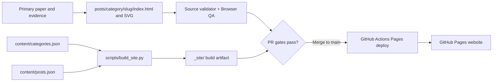

# Architecture and publishing model

## One-way build pipeline

`_site/` is disposable and ignored by Git. All category pages, the archive, homepage cards, JSON search index, RSS and sitemap are derived from manifests, not manually maintained. Original paper articles remain self-contained HTML reading artifacts with independent SVG/code sources alongside them.

## Reasoning and inference taxonomy

`reasoning` covers answer-quality algorithms (CoT, Self-Consistency, test-time search/verification); `inference` covers serving infrastructure (KV Cache, batching, latency/throughput). `retrieval-rag` covers ANN, retrieval/reranking and RAG; `agents` covers Reasoning–Acting, planning, tool calling and memory. `systems` owns kernels, compilers and GPU communication; `training` owns distributed model training, mixed precision and checkpointing. Both share the manifest-driven publishing pipeline.

## Path layout and routing

- GitHub Pages target: `https://1998x-stack.github.io/xm-posts/`.
- Source HTML: `posts/<category>/<slug>/index.html`.
- Published article route: `/xm-posts/posts/<category>/<slug>/`.
- Category route: `/xm-posts/categories/<category>/` and stable second-level anchors `/xm-posts/categories/<category>/#topic-<topic>`.
- Global taxonomy route: `/xm-posts/topics/`; each topic links to its category's anchor.
- Other routes: `/xm-posts/archive/`, `/xm-posts/posts.json`, `/xm-posts/feed.xml`, `/xm-posts/sitemap.xml`, `/xm-posts/robots.txt`. The RSS 2.0 feed includes Atom self-discovery, Dublin Core day-precision modification dates and category/topic metadata; see [`docs/rss.md`](rss.md) for the stable GUID/date contract.
- Shared site assets: `site/assets/`; build places them at `_site/assets/`.
- Links use **relative references** to work in project-site subpaths; `--base-url` controls absolute canonical, RSS and sitemap URLs.

## Content and publication schema

`content/categories.json` is an ordered array of `{slug,title,english,description,topics}`, where `topics` is a non-empty array of `{slug,title}` with unique, stable kebab-case slugs **within each category**. `content/posts.json` contains `{slug,title,subtitle,category,topic,status,published,updated,reading_minutes,tags,summary,paper,illustration,cover}`; a published article's `cover` is a unique local SVG and its explanatory caption. The required `topic` must exist in the selected category's `topics` list; `tags` provide cross-topic search without changing the single primary placement. Status is either `draft` or `published`, slugs are unique lowercase kebab-case, categories must be registered, and dates use ISO `YYYY-MM-DD`.

The knowledge map, category grouped sections and archive labels are generated from those two manifests; missing article categories, duplicate topic IDs and broken fragment anchors fail CI. Topic IDs are not physical folders, so existing article URLs remain stable. Category/topic slugs should not be renamed without deliberate migration and redirect support.

Only registered `published` posts with existing HTML are copied to `_site`. Category placeholder READMEs are never copied. Drafts can live in their own source directories and manifest but must be excluded from published cards, category pages, RSS, sitemap and JSON search data. `.py`, `evidence.json`, developer Skills, tests and secrets never enter the Pages artifact.

## Multi-agent Skill mirrors

`skills/olah-style-paper-posts/` is authoritative. Four **real copies** live at `.claude/skills/`, `.pi/skills/`, `.agent/skills/`, `.opencode/skills/`. Update the canonical skill and run `python scripts/sync_skills.py`; `--check` is a mandatory CI invariant. Avoid symlinks and divergent agent-specific forks. Provenance is stored in the canonical `UPSTREAM.md`.

## CI/CD control plane

Workflow `.github/workflows/publish.yml`:

- On PR: Python / Chromium installation → skill mirror check → tests → build → link and content validation → desktop/mobile/interactions browser QA → upload tested site as a preview artifact. **No deploy**.
- On push to `main` / manual dispatch: identical checks, then a deployment job downloads the *same* validated artifact; it checks Pages settings, attempts first-time API enablement using a pages-write workflow token if necessary, configures Pages, uploads the Pages artifact and deploys to `github-pages` environment.
- If repository policy rejects API initialization, an administrator must select **Settings → Pages → Source → GitHub Actions** once, and re-run the workflow. Merely committing the workflow does not prove the site is live.
- Generated `_site/` never needs an independent branch or commit; repeat the same build for each merged Post.

Public Pages can reveal anything in the artifact: builders use a strict allowlist of published directories rather than deploying the whole source checkout.

## Publication invariants

Each article needs one H1, semantic `<main>`, anchored navigation, captions, accessible SVGs with unique IDs across the document, unbroken local links, primary-paper references, mobile/print layout, accessible interaction and no irrelevant build-process chatter. Preserve original-paper scope and distinguish later variants. QA results and Pages status must be actually observed before claimed.
